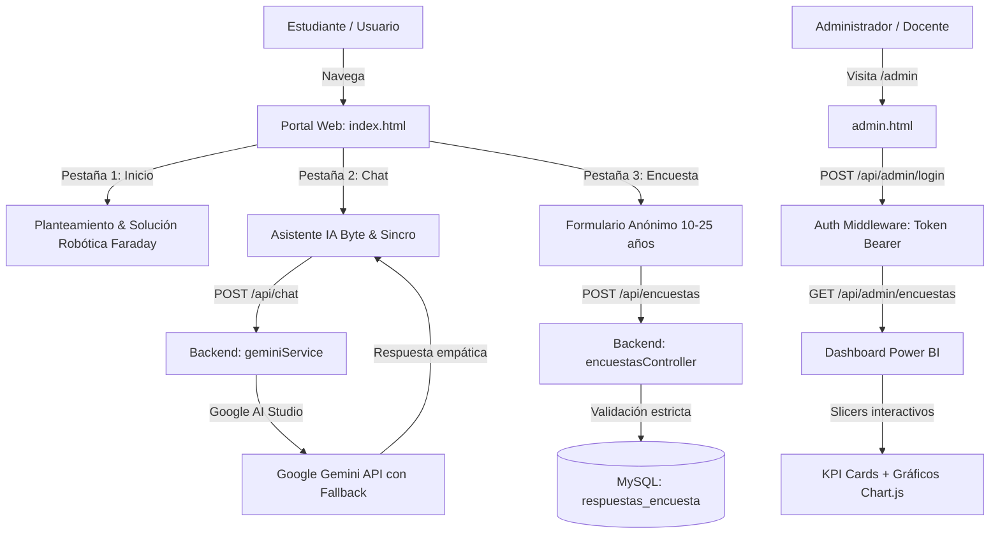

# 📱 Sincronía Digital · Aprendiendo Robótica y Bienestar en Adolescentes

> **Proyecto de Participación Estudiantil (PPE)**  
> Plataforma integral Full Stack que combina concientización estudiantil sobre adicción al smartphone, un prototipo de contenedor inteligente con **Jaula de Faraday**, un **asistente conversacional con IA (Byte)** integrado con Google Gemini y un **Dashboard de Analítica estilo Microsoft Power BI**.

---

## 🏛️ Arquitectura del Proyecto

El sistema ha sido refactorizado siguiendo una arquitectura limpia, desacoplada y modular:

```text
PPE/
├── src/                               # Núcleo del servidor Backend (Node.js + Express)
│   ├── config/                        # Configuraciones centralizadas
│   │   ├── env.js                     # Carga y validación de variables de entorno (.env)
│   │   └── db.js                      # Conexión y Pool de MySQL2 (Promise-based)
│   ├── middlewares/                   # Middlewares de seguridad y control
│   │   ├── auth.js                    # Autenticación Bearer para administradores
│   │   ├── rateLimiter.js             # Limitador de tasa (Rate Limiting) por IP
│   │   ├── security.js                # Sanitización preventiva contra XSS e inyecciones
│   │   └── errorHandler.js            # Manejador centralizado de errores
│   ├── controllers/                   # Orquestación de peticiones HTTP
│   │   ├── encuestasController.js     # Recepción y validación estricta de encuestas
│   │   ├── adminController.js         # Autenticación, analítica y gestión admin
│   │   └── chatController.js          # Control del flujo conversacional con IA
│   ├── services/                      # Lógica de negocio y servicios externos
│   │   ├── encuestasService.js        # Consultas SQL sobre la tabla existente
│   │   └── geminiService.js           # Integración con Google Gemini (fallback y prompt)
│   ├── routes/                        # Definición de endpoints REST
│   │   └── apiRoutes.js               # Rutas (/api/encuestas, /api/chat, /api/admin)
│   ├── app.js                         # Configuración de Express, Helmet, CORS y estáticos
│   └── server.js                      # Inicialización y arranque del servidor HTTP
├── public/                            # Archivos Frontend de acceso público
│   ├── css/                           # Hojas de estilo modulares
│   │   ├── styles.css                 # Paleta High-Tech Dark, tipografía y utilidades
│   │   ├── chat.css                   # FAB flotante neón, burbujas e indicador de IA
│   │   └── admin.css                  # Estilo Power BI, Slicers, KPI cards y badges
│   ├── js/                            # Lógica del cliente
│   │   ├── app.js                     # SPA Navigation y Floating Action Button (FAB)
│   │   ├── chat.js                    # Chat interactivo con Byte AI y chips de inicio
│   │   ├── survey.js                  # Validación y envío asíncrono de encuestas
│   │   └── admin.js                   # Filtros en tiempo real, KPIs dinámicos y Chart.js
│   ├── assets/                        # Recursos gráficos y multimedia
│   │   └── byte1.jfif                 # Portada del proyecto y avatar
│   ├── index.html                     # Portal principal (Inicio, Encuesta y Chat)
│   └── admin.html                     # Dashboard analítico tipo Power BI
├── server.js                          # Entrada raíz compatible con "node server.js"
├── package.json                       # Metadatos del proyecto y dependencias
├── .env                               # Variables de entorno privadas (no versionar)
├── .gitignore                         # Exclusiones de control de versiones
└── README.md                          # Documentación técnica completa
```

---

## ⚙️ Requisitos Previos e Instalación

### 1. Requisitos de Software
* **Node.js** v18.0.0 o superior
* **MySQL** v8.0 o MariaDB
* Clave de API de **Google Gemini** (gratuita en [Google AI Studio](https://aistudio.google.com/apikey))

### 2. Instalación de Dependencias
Abre una terminal en el directorio del proyecto y ejecuta:
```bash
npm install
```

### 3. Configuración de Variables de Entorno (`.env`)
Crea o edita el archivo `.env` en la raíz con los siguientes parámetros:

```ini
# Puerto del servidor
PORT=3000

# Clave de API de Google Gemini (obligatoria para el chat con Byte)
GEMINI_API_KEY=tu_api_key_aqui
GEMINI_MODEL=gemini-2.5-flash

# Contraseña de acceso al Dashboard Administrativo
ADMIN_PASS=admin123

# Conexión a la Base de Datos MySQL
DB_HOST=localhost
DB_USER=root
DB_PASS=tu_password_mysql
DB_NAME=encuestas_db
```

---

## 🚀 Puesta en Marcha

Inicia el servidor en modo producción o desarrollo con cualquiera de los dos comandos:
```bash
npm start
# O alternativamente:
node server.js
```

El servidor quedará disponible en:
* 🌐 **Portal Público:** `http://localhost:3000`
* 📊 **Dashboard Power BI:** `http://localhost:3000/admin`

---

## 🔄 Flujo del Sistema



---

## 🛡️ Medidas de Seguridad y Buenas Prácticas

1. **Protección de Cabeceras HTTP:** Implementación de `helmet` con políticas CSP adaptadas a fuentes de Google Fonts, FontAwesome y Chart.js.
2. **Mitigación de XSS e Inyecciones:** Sanitización automática de textos en el middleware `security.js` y uso estricto de sentencias preparadas (*Prepared Statements*) en MySQL2.
3. **Control de Abuso (Rate Limiting):**
   * `/api/chat`: Máximo 60 peticiones/minuto por IP para proteger la cuota de tokens.
   * `/api/encuestas`: Máximo 30 encuestas/minuto por IP contra spam.
   * `/api/admin/login`: Máximo 15 intentos cada 15 minutos para prevenir ataques de fuerza bruta.
4. **Validación Criptográfica en Tiempo Constante:** Verificación de credenciales con `crypto.timingSafeEqual` para neutralizar ataques de canal lateral por temporización.
5. **Privacidad de Datos:** La encuesta no recopila correos ni nombres; el registro es completamente anónimo.

---

## 🤖 Comportamiento del Asistente Byte
* **Tono empático:** No actúa como un formulario rígido ni realiza preguntas secas.
* **Reflexión sobre dopamina y hábitos:** Explica de forma accesible el impacto de las pantallas en el descanso nocturno.
* **Sugerencias Rápidas (Chips):** El estudiante puede pulsar temas prediseñados para iniciar charlas sobre concentración, el funcionamiento de la Jaula de Faraday o pausas digitales.

---

## 📊 Dashboard Estilo Power BI
* **Slicers (Filtros en Vivo):** Filtra por edad (10-14, 15-18, 19+), horas en pantalla, impacto en ánimo (P7) o uso nocturno (P3) sin recargar la página.
* **KPIs Dinámicos:** Muestra en tiempo real el porcentaje de estudiantes con uso crítico (+4h), afectación del sueño y disposición al cambio.
* **Gráficos Multi-eje:** Donut charts, gráficos de columnas y barras agrupadas con paleta corporativa y alto contraste visual.
